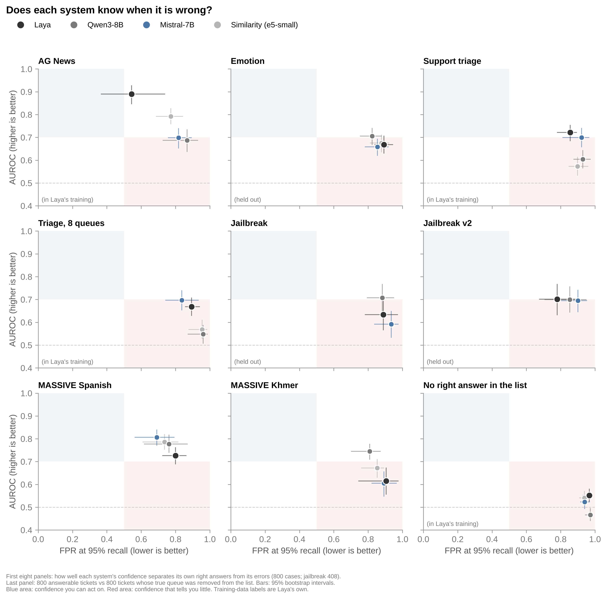
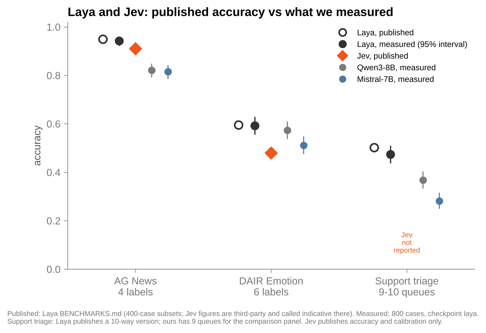

# Does Laya know when it is wrong?

[Laya](https://github.com/NandhaKishorM/laya) is a 421M-parameter decision model. Its benchmark compares it with TypeSafe's Jev on **accuracy**: how often the answer is right.

Accuracy does not tell you **which** answers you can trust. If you put a model in front of customers, tickets or security alerts, you need its confidence to be low when it is wrong, so you can send those cases to a person. This repository measures that, on the same public datasets Laya uses, and shows every case.

## What we found

**1. Laya's published accuracy holds up.** We measured 0.942 on AG News (published 0.950) and 0.592 on DAIR Emotion (published 0.595), with 800 cases each.

**2. Its confidence is only useful on the dataset it was trained on.** On AG News, which Laya's repository lists as part of its training mix, confidence separates right from wrong answers well (AUROC 0.89). On every other dataset it stays between 0.62 and 0.73. To keep 95% of its right answers you would still accept 78% to 91% of its errors.

**3. No system can tell when none of the options is right.** Give Laya a support ticket whose true queue is missing from the list and it is as confident as when the queue is there (AUROC 0.55, where 0.5 is a coin toss). Qwen3-8B, Mistral-7B and plain similarity do no better.

Points 2 and 3 are not specific to Laya. Two general-purpose LLMs and a similarity baseline fail in the same way. The issue is what the benchmark measures: a model can win on accuracy and still give you no usable signal about when to trust it.





## How to read the main figure

Each point is one system on one dataset.

- **AUROC** (vertical): the chance that a random right answer gets more confidence than a random wrong one. 0.5 means confidence carries no information. Higher is better.
- **FPR at 95% recall** (horizontal): set the threshold so you keep 95% of the right answers. This is the share of wrong answers that still pass. Lower is better.
- The blue area is where confidence is good enough to act on. The red area is where it tells you little.

## What was tested

| dataset | cases | options | in Laya's training? |
|---|---|---|---|
| AG News | 800 | 4 topics | yes |
| DAIR Emotion | 800 | 6 emotions | no (held out) |
| Support tickets (Tobi-Bueck) | 800 | 10 queues | yes |
| Support tickets, 8 queues | 800 | 8 queues | yes |
| Toxic-chat jailbreak, two wordings | 408 | yes / no | no (held out) |
| MASSIVE intent, Spanish and Khmer | 800 each | 20 intents | not stated |
| Tickets with no right answer | 800 + 800 | 8 queues | yes |

"In Laya's training" is what Laya's own repository says (`research/scripts/bench_apps.py`, `BENCHMARKS.md`, `README.md`). The cases are the first 800 rows of each public dataset with the option texts from Laya's own benchmark script, seed 13.

Systems:

- **Laya**, its recommended `Router`, checkpoint `laya`
- **Qwen3-8B** (4-bit) and **Mistral-7B-Instruct v0.3**, scoring the options in one forward pass
- **Similarity**, the cosine between the text and each option with `multilingual-e5-small`

Confidence is the top probability for every system. Intervals are 95% (Wilson for accuracy, 1,000 bootstrap resamples for AUROC and FPR).

## Reproduce

Everything in the figures comes from the per-case predictions in `data/`.

```bash
git clone https://github.com/Javihaus/laya-audit
cd laya-audit
pip install -r requirements.txt
cd notebooks && jupyter notebook audit.ipynb
```

`audit.ipynb` runs on a laptop in under a minute and writes `results.csv` and the figures.

To regenerate the Laya and similarity predictions yourself, run `notebooks/reproduce_predictions.ipynb` on a free Colab T4 (about 15 minutes). Two independent runs of Laya, a day apart, chose the same option on all 6,416 cases.

## Limits

- One run per system, on 800 cases per dataset (408 for jailbreak).
- Jev is a closed API and publishes accuracy and calibration only, so it could not be measured here.
- Confidence is the top probability. Laya's raw scores do somewhat better on the tickets with no right answer (AUROC 0.68), but most of that gain comes from which queue is missing, not from reading the ticket (0.62 once that is controlled for).
- The ticket labels look noisy: no system passes 48% accuracy on the ticket datasets.

## Files

| path | contents |
|---|---|
| `data/predictions_v2.csv` | every case: probabilities from Laya, Qwen3-8B and similarity |
| `data/predictions_mistral_and_laya_scores.csv` | every case: Mistral-7B confidence and correctness, Laya raw scores |
| `notebooks/audit.ipynb` | all numbers and figures in this README |
| `notebooks/reproduce_predictions.ipynb` | rebuilds the cases and the Laya and similarity predictions |
| `results.csv` | the table behind the figures |

Author: Javier Marín. MIT licence.
